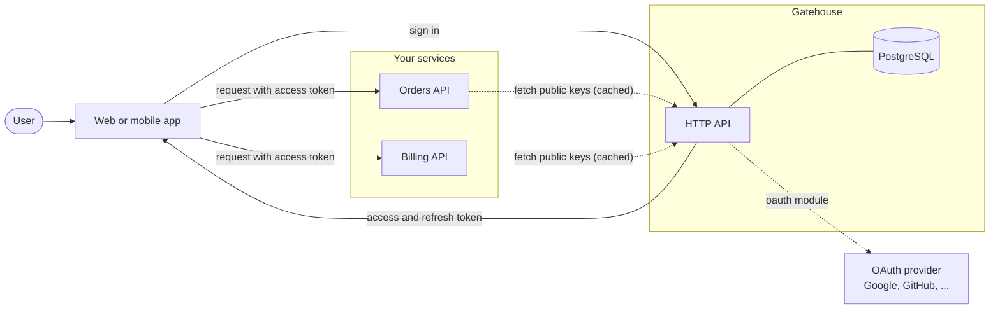
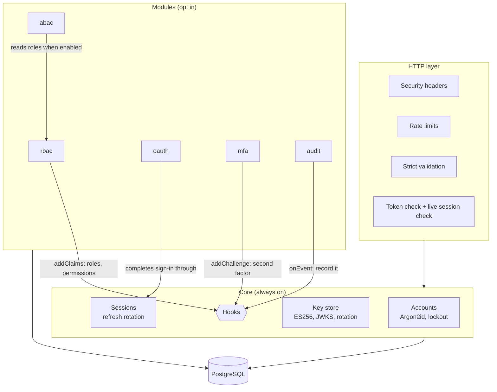

# Gatehouse

[](https://github.com/Akinz-bobo/gatehouse/actions/workflows/ci.yml)
[](https://github.com/Akinz-bobo/gatehouse/actions/workflows/codeql.yml)
[](LICENSE)

A modular authentication and authorization service. Run it as plain JWT sign-in, or switch on roles, attribute-based policies, OAuth sign-in, two-factor and an audit log, one environment variable at a time.

```bash
MODULES=                       # JWT authentication only
MODULES=rbac                   # + roles and permissions
MODULES=rbac,abac,mfa,audit    # + policies, two-factor and an audit trail
MODULES=rbac,abac,oauth,mfa,audit   # everything
```

A module that is off adds no endpoints, no token claims and no work at sign-in. Its routes answer `404`.

> **Status.** Gatehouse is a reference implementation: a complete, tested service written to show how these pieces fit together securely. It has not had an independent security audit. Read the [threat model](docs/threat-model.md), including its list of what is deliberately left out, before putting it in front of real users.

## Contents

- [What you get](#what-you-get)
- [How it fits into a system](#how-it-fits-into-a-system)
- [Quick start](#quick-start)
- [Choosing modules](#choosing-modules)
- [Verifying tokens in your services](#verifying-tokens-in-your-services)
- [Security design](#security-design)
- [Configuration](#configuration)
- [Project layout](#project-layout)
- [Development](#development)
- [Documentation](#documentation)

## What you get

| Part      | Switch          | What it does                                                                                                                                                                                                    |
| --------- | --------------- | --------------------------------------------------------------------------------------------------------------------------------------------------------------------------------------------------------------- |
| **Core**  | always on       | Registration, password sign-in, ES256 access tokens, rotating refresh tokens with theft detection, session list and revocation, password change and reset, account lockout, JWKS endpoint, signing key rotation |
| **rbac**  | `MODULES=rbac`  | Roles made of permissions such as `invoices:read`, wildcards such as `invoices:*`, roles and permissions as token claims, a live permission check endpoint                                                      |
| **abac**  | `MODULES=abac`  | Allow and deny policies with conditions over subject, resource and context attributes. Deny overrides, default deny                                                                                             |
| **oauth** | `MODULES=oauth` | Sign in with any OAuth 2.0 or OpenID Connect provider, using PKCE, single-use state and a redirect allow-list. Explicit account linking                                                                         |
| **mfa**   | `MODULES=mfa`   | TOTP two-factor (RFC 6238) that works with any authenticator app, with single-use recovery codes                                                                                                                |
| **audit** | `MODULES=audit` | An append-only log of sign-ins, failures, token theft, and role, policy and key changes                                                                                                                         |

## How it fits into a system

Gatehouse issues tokens. Your services verify them on their own, using public keys, without calling Gatehouse on every request and without sharing a secret with it.



Inside, a small core owns identity and tokens. Modules attach to three extension points and never reach into each other.



More diagrams, including the data model and every sign-in flow, are in [docs/architecture.md](docs/architecture.md).

## Quick start

You need Docker. This starts PostgreSQL, runs the migrations and starts Gatehouse on port 4000 with the `rbac`, `abac`, `mfa` and `audit` modules on.

```bash
git clone https://github.com/Akinz-bobo/gatehouse.git
cd gatehouse
make up
```

Then, in another terminal:

```bash
# Create an account
curl -s localhost:4000/v1/auth/register -H 'content-type: application/json' \
  -d '{"email":"ada@example.com","password":"correct horse battery staple"}'

# Sign in
curl -s localhost:4000/v1/auth/login -H 'content-type: application/json' \
  -d '{"email":"ada@example.com","password":"correct horse battery staple"}'
# => { "mfaRequired": false, "accessToken": "eyJ...", "refreshToken": "...", "tokenType": "Bearer", "expiresIn": 900 }

# Use the access token
curl -s localhost:4000/v1/auth/me -H "authorization: Bearer $ACCESS_TOKEN"
```

- Interactive API reference: <http://localhost:4000/docs>
- Public keys: <http://localhost:4000/.well-known/jwks.json>
- Walk every core flow in one go: `make smoke`

To administer roles, policies, keys and the audit log you need a superuser. There is deliberately no API that creates one. Grant it from the command line:

```bash
docker compose exec gatehouse node dist/cli.js grant-superuser ada@example.com
```

The compose file uses a public, throwaway encryption key. For anything else, generate your own with `pnpm cli generate-key`.

## Choosing modules

Pick a row, set `MODULES`, and follow the guide.

| You want                                                     | `MODULES`   | Guide                                        |
| ------------------------------------------------------------ | ----------- | -------------------------------------------- |
| Sign-in and tokens, nothing else                             | _(empty)_   | [Core](docs/guides/core.md)                  |
| "Admins can do X, editors can do Y"                          | `rbac`      | [Roles and permissions](docs/guides/rbac.md) |
| "Owners can edit their own documents, but not archived ones" | `rbac,abac` | [Policies](docs/guides/abac.md)              |
| "Sign in with Google"                                        | `oauth`     | [OAuth sign-in](docs/guides/oauth.md)        |
| Two-factor authentication                                    | `mfa`       | [Two-factor](docs/guides/mfa.md)             |
| A record of who did what                                     | `audit`     | [Audit log](docs/guides/audit.md)            |

Modules compose. With `mfa` on, an OAuth sign-in is challenged for a code too. With `rbac` on, `abac` conditions can test the user's roles, and role holders can be delegated administration (`auth:roles:manage`, `auth:policies:manage`, `auth:audit:read`, `auth:keys:rotate`). Need something that is not here? [Writing a module](docs/guides/writing-a-module.md) takes one file and one registry entry.

## Verifying tokens in your services

A resource server needs the issuer URL and nothing else. Any JWT library that supports JWKS works. In Node.js with [`jose`](https://github.com/panva/jose):

```ts
import { createRemoteJWKSet, jwtVerify } from 'jose';

const ISSUER = 'https://auth.example.com';
const keys = createRemoteJWKSet(new URL(`${ISSUER}/.well-known/jwks.json`));

export async function verifyAccessToken(token: string) {
  const { payload } = await jwtVerify(token, keys, {
    issuer: ISSUER,
    audience: 'gatehouse',
    algorithms: ['ES256'], // never let the token choose the algorithm
  });
  return payload; // { sub, sid, email, roles?, permissions?, exp, ... }
}
```

Always check all three of issuer, audience and algorithm. Claims are as fresh as the token (15 minutes by default). For decisions that cannot tolerate that, ask Gatehouse directly with `POST /v1/authz/check` or `POST /v1/authz/evaluate`. See [Integrating a service](docs/guides/integrating-a-service.md).

## Security design

No authentication system is unbreakable, and this one does not claim to be. What it does is name the attacks it defends against, show the defence, and prove each one with a test. The full list, with the residual risks, is the [threat model](docs/threat-model.md). The short version:

| Attack               | Defence                                                                                                                                                                                                |
| -------------------- | ------------------------------------------------------------------------------------------------------------------------------------------------------------------------------------------------------ |
| Stolen database      | Passwords hashed with Argon2id. Refresh, reset and recovery tokens stored as SHA-256 hashes. Signing keys and TOTP secrets encrypted with AES-256-GCM under a key that is not in the database          |
| Password guessing    | Per-IP rate limits, tighter on sign-in endpoints. Account lockout that doubles with each further failure. Minimum length 12 with a common-password check (NIST SP 800-63B)                             |
| Account enumeration  | Identical response, and matching work, for a wrong password, unknown email, locked account and disabled account. Password reset always answers `202`                                                   |
| Forged tokens        | ES256 only. `alg: none` and algorithm swaps are rejected, and issuer and audience are checked. Private keys never leave the service                                                                    |
| Stolen refresh token | Tokens are single-use. A replayed token ends the whole session for both parties and is recorded                                                                                                        |
| Stolen access token  | 15-minute lifetime. Sign-out, password change and theft detection kill it immediately on Gatehouse's own endpoints                                                                                     |
| Privilege escalation | Request bodies are strict, so `isSuperuser` cannot be smuggled in. Superusers are created only from the CLI. Administrative permissions are read from the database on each request, not from the token |
| OAuth attacks        | PKCE, single-use hashed `state`, exact-match redirect allow-list, tokens never in URLs, no automatic account linking by email                                                                          |
| Second-factor bypass | The intermediate MFA token has its own audience and is useless as an access token. TOTP codes and recovery codes are single-use                                                                        |
| Log tampering        | The audit log rejects `UPDATE` and `DELETE` at the database level                                                                                                                                      |

Reporting a vulnerability: see [SECURITY.md](SECURITY.md).

## Configuration

Everything is set through environment variables and validated at startup. The service refuses to start on an invalid value. See [.env.example](.env.example) for a commented template.

| Variable                                         | Default                         | Meaning                                                                      |
| ------------------------------------------------ | ------------------------------- | ---------------------------------------------------------------------------- |
| `DATABASE_URL`                                   | required                        | PostgreSQL connection string                                                 |
| `ISSUER`                                         | required                        | Public base URL of the service, and the `iss` claim                          |
| `KEY_ENCRYPTION_KEY`                             | required                        | 32 random bytes, base64. Encrypts signing keys and TOTP secrets at rest      |
| `MODULES`                                        | _(empty)_                       | Comma-separated: `rbac`, `abac`, `oauth`, `mfa`, `audit`                     |
| `AUDIENCE`                                       | `gatehouse`                     | The `aud` claim                                                              |
| `ACCESS_TOKEN_TTL_SECONDS`                       | `900`                           | Access token lifetime (60 to 3600)                                           |
| `REFRESH_TOKEN_TTL_SECONDS`                      | `2592000`                       | Refresh token lifetime (30 days)                                             |
| `RATE_LIMIT_MAX`                                 | `300`                           | Requests per minute per IP                                                   |
| `AUTH_RATE_LIMIT_MAX`                            | `20`                            | Requests per minute per IP on sign-in, registration, reset and MFA endpoints |
| `MAX_FAILED_LOGINS`                              | `5`                             | Failures before an account locks                                             |
| `LOCKOUT_SECONDS`                                | `900`                           | Length of the first lock. Doubles with each further failure, up to 64 times  |
| `PASSWORD_HASH_MEMORY_KIB`                       | `19456`                         | Argon2id memory cost                                                         |
| `PASSWORD_HASH_ITERATIONS`                       | `2`                             | Argon2id time cost                                                           |
| `CORS_ORIGINS`                                   | _(empty)_                       | Allowed browser origins. Empty disables CORS                                 |
| `OAUTH_PROVIDERS`                                | `[]`                            | JSON array of providers, for the `oauth` module                              |
| `OAUTH_REDIRECT_ALLOWLIST`                       | _(empty)_                       | Exact URLs a browser may be returned to after OAuth                          |
| `PORT`, `HOST`, `LOG_LEVEL`, `DATABASE_POOL_MAX` | `4000`, `0.0.0.0`, `info`, `10` | The usual                                                                    |

## Project layout

```
migrations/          SQL migrations, applied in order
openapi/             The API description, kept in step with the routes by a test
scripts/smoke.sh     End-to-end check against a running stack
src/
  config.ts          Environment parsing and validation
  crypto/            Argon2id, AES-256-GCM secret box, tokens, TOTP
  core/              Accounts, sessions, key store, sign-in, hooks
  modules/           rbac, abac, oauth, mfa, audit, and the registry
  http/              App wiring, authentication guard, core routes
  cli.ts             Key generation and superuser management
test/
  unit/              Pure logic: TOTP vectors, policy engine, permissions
  integration/       Every endpoint against a real PostgreSQL
docs/                Architecture, threat model, guides, decision records
```

## Development

Requires Node.js 22, pnpm and Docker.

```bash
pnpm install
make db          # PostgreSQL for tests, on port 5546
make test        # unit and integration tests
make check       # format, lint, types and tests: everything CI runs
pnpm dev         # run the service with reload (needs a .env, see .env.example)
```

CI runs formatting, linting, type checks, unit tests, integration tests against PostgreSQL, a dependency audit, a container build, and the smoke test against the built container stack. CodeQL scans every push.

See [CONTRIBUTING.md](CONTRIBUTING.md).

## Documentation

- [Architecture](docs/architecture.md): components, data model and sequence diagrams for every flow
- [Threat model](docs/threat-model.md): what is defended, how, and what is not
- Guides: [core](docs/guides/core.md), [rbac](docs/guides/rbac.md), [abac](docs/guides/abac.md), [oauth](docs/guides/oauth.md), [mfa](docs/guides/mfa.md), [audit](docs/guides/audit.md), [integrating a service](docs/guides/integrating-a-service.md), [running in production](docs/guides/production.md), [writing a module](docs/guides/writing-a-module.md)
- [Decision records](docs/adr): why it is built this way
- API reference: [openapi/openapi.yaml](openapi/openapi.yaml), or `/docs` on a running instance

## License

[MIT](LICENSE)
