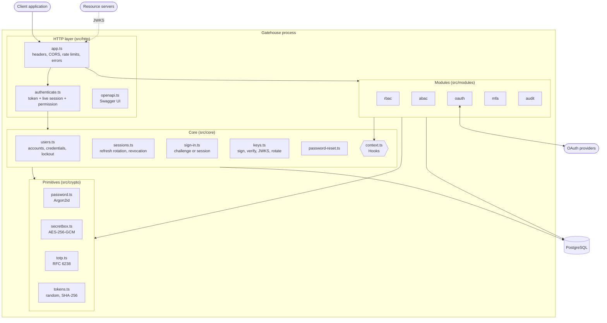
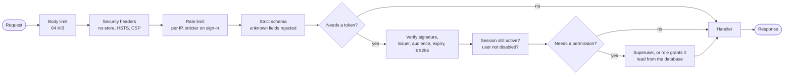
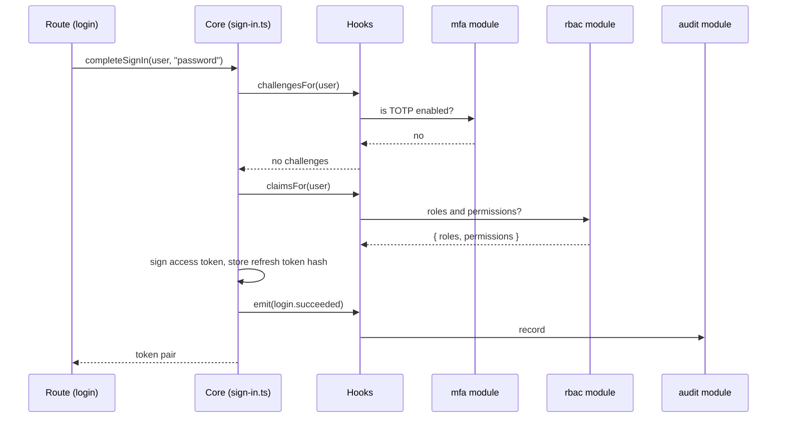
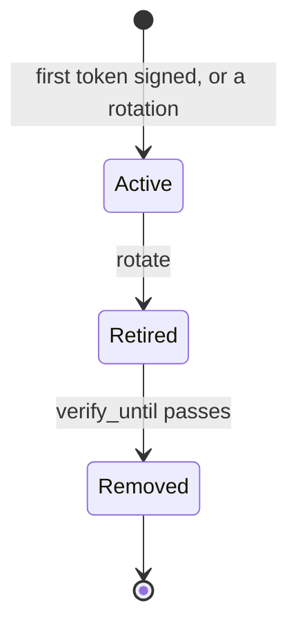
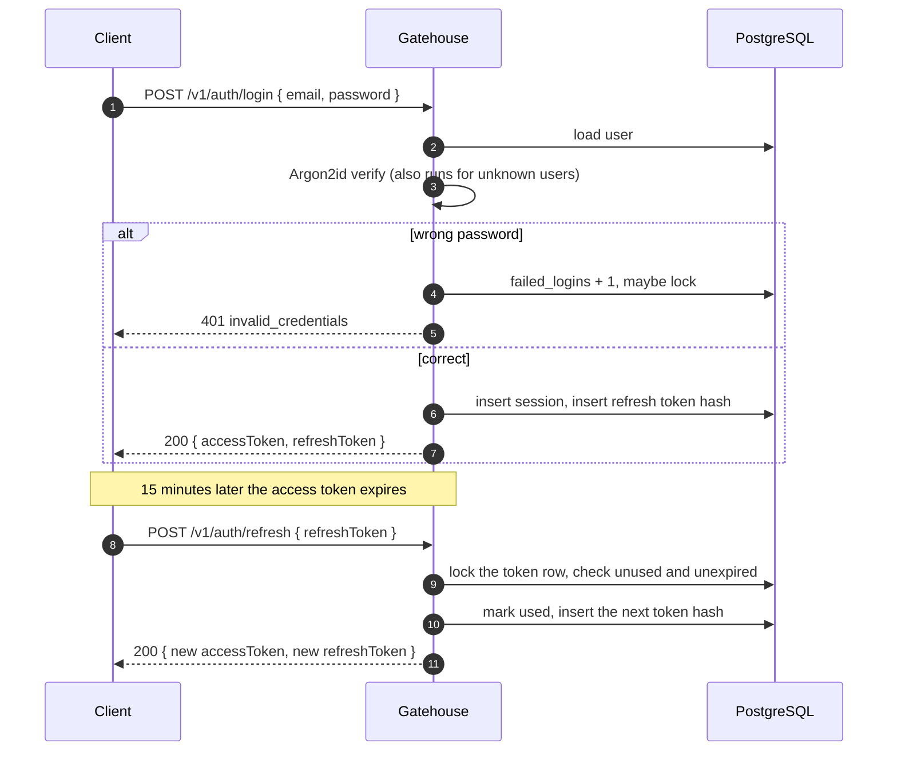
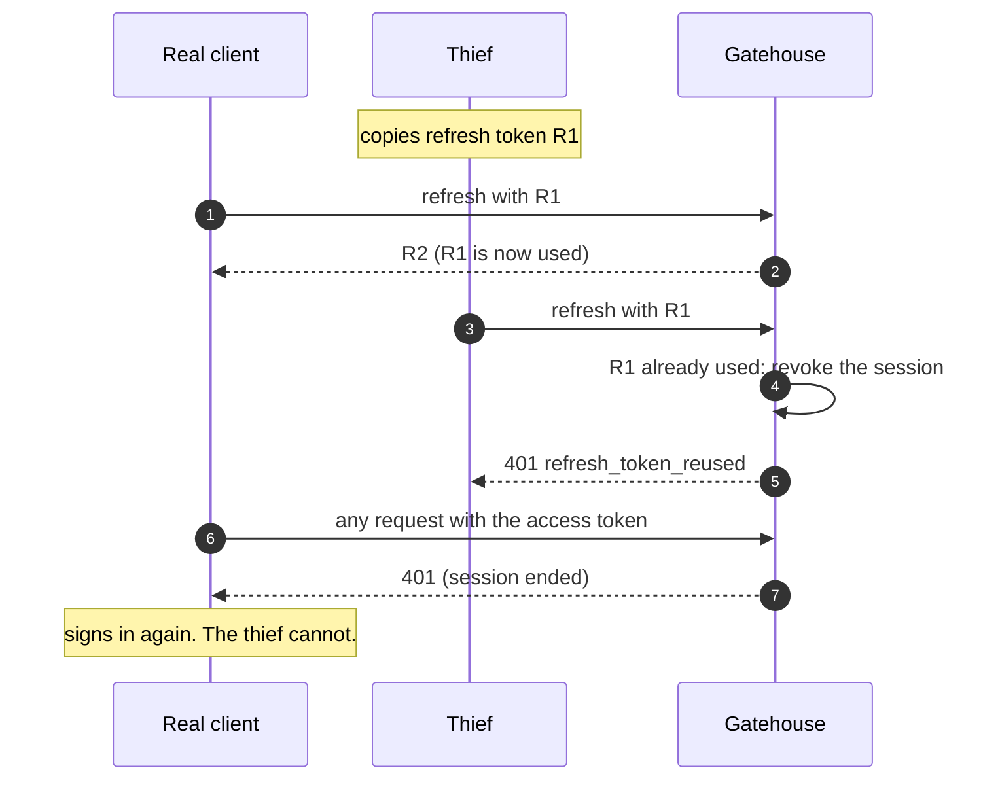
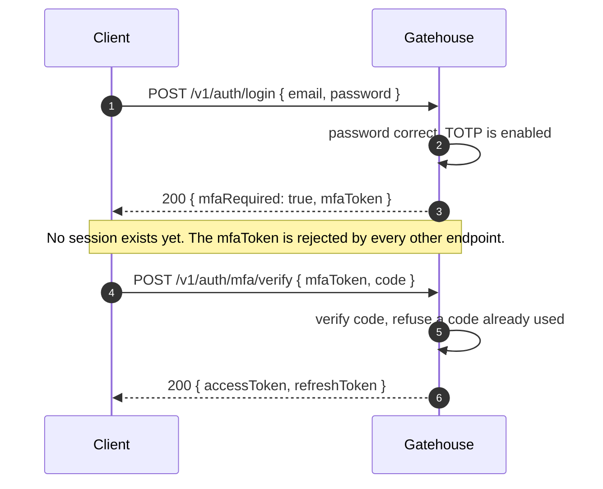
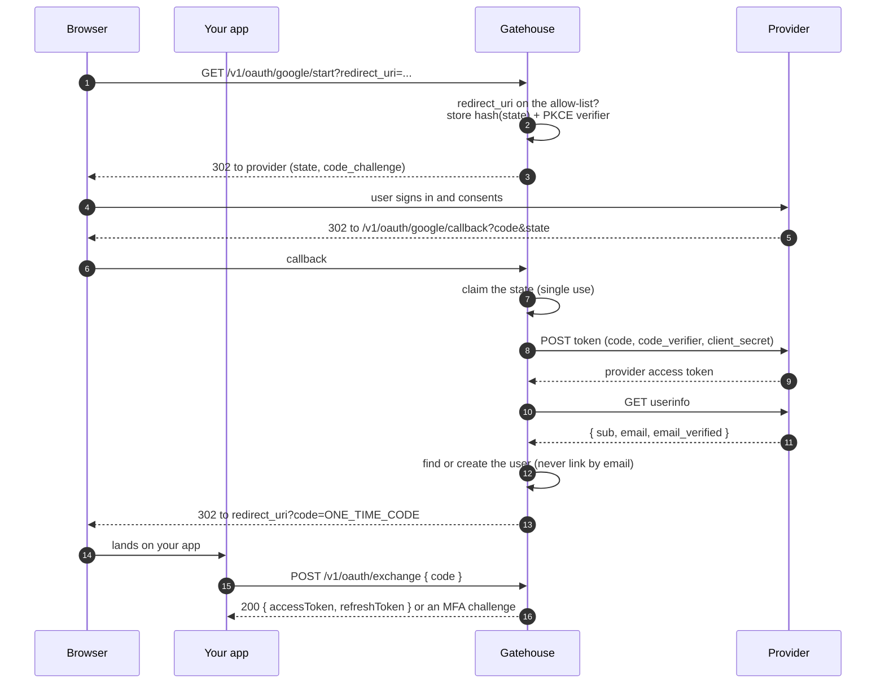
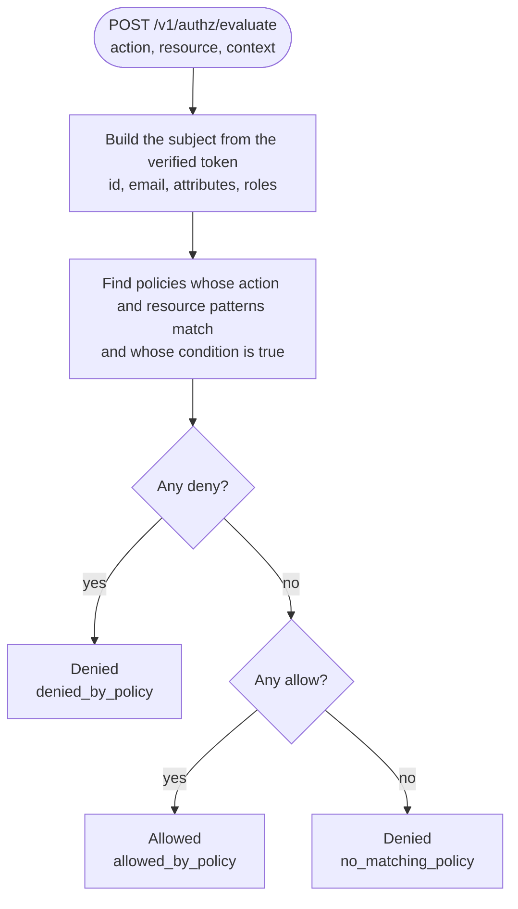
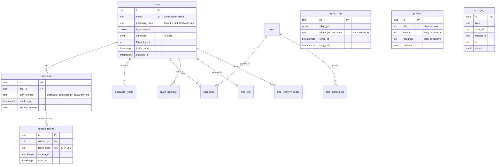

# Architecture

This document explains how Gatehouse is put together: the pieces, how a request moves through them, how the data is laid out, and what each sign-in flow looks like on the wire.

- [Design goals](#design-goals)
- [Components](#components)
- [Request pipeline](#request-pipeline)
- [The module system](#the-module-system)
- [Tokens and sessions](#tokens-and-sessions)
- [Flows](#flows)
- [Data model](#data-model)
- [Scaling and failure](#scaling-and-failure)

## Design goals

1. **Pay only for what you use.** A deployment that needs JWT sign-in should not carry OAuth callbacks or a policy engine. Disabled modules register nothing.
2. **Secure defaults, no insecure switches.** There is no option to turn off hashing, pick a weaker algorithm or skip token rotation.
3. **Resource servers stay independent.** They verify tokens with public keys and never hold a secret that could mint one.
4. **Every defence is a test.** If a property matters (a replayed token ends the session), a test fails when it breaks.
5. **Small enough to read.** About three thousand lines of TypeScript, no framework magic, one database.

## Components



Dependencies point one way: HTTP depends on core and modules, modules depend on core, core depends on the crypto primitives. The core never imports a module, with one exception that is called out in the code: the permission guard reads roles when `rbac` is enabled.

## Request pipeline

Every request passes the same gates, in this order. A request that fails one never reaches the next.



Errors leave in one shape, `{ "error": { "code", "message", "details" } }`. Unexpected errors are logged with the request id and answered with a bare `500`, so internals never leak.

## The module system

A module is an object with a name, an optional `setup` and a `routes` function:

```ts
export interface Module {
  name: ModuleName;
  setup?(context: Context): void; // attach to the core's hooks
  routes(app: FastifyInstance, context: Context): void; // add endpoints
}
```

At startup the service reads `MODULES`, looks each name up in the registry and calls `setup` then `routes`. Nothing else knows the module exists.

The core offers three hooks:

| Hook           | Called when                                               | Used by                               |
| -------------- | --------------------------------------------------------- | ------------------------------------- |
| `addClaims`    | An access token is minted                                 | `rbac` adds `roles` and `permissions` |
| `addChallenge` | A user has proved their identity, before a session starts | `mfa` demands a TOTP code             |
| `onEvent`      | Something security-relevant happened                      | `audit` writes it down                |



With no modules enabled, the hooks have no listeners and sign-in is two database writes and a signature.

## Tokens and sessions

There are three kinds of token, each with one job.

| Token         | Form                            | Lifetime            | Stored as    | Job                            |
| ------------- | ------------------------------- | ------------------- | ------------ | ------------------------------ |
| Access token  | ES256 JWT                       | 15 minutes          | not stored   | Prove identity to any service  |
| Refresh token | 32 random bytes                 | 30 days, single-use | SHA-256 hash | Get a new access token         |
| MFA token     | ES256 JWT, audience `<aud>:mfa` | 5 minutes           | not stored   | Finish a sign-in, nothing else |

An access token carries `sub` (user id), `sid` (session id), `email`, and whatever modules add. A **session** is the server-side record behind one sign-in. Ending it, by sign-out, password change, reset or theft detection, invalidates its refresh tokens, and Gatehouse's own endpoints stop accepting its access tokens at once.

### Signing keys



| State   | Signs new tokens | Published in JWKS | Notes                                                                                               |
| ------- | ---------------- | ----------------- | --------------------------------------------------------------------------------------------------- |
| Active  | yes              | yes               | Exactly one at a time, enforced by a unique index                                                   |
| Retired | no               | yes               | Tokens it signed keep verifying until `verify_until`, which is the token lifetime plus five minutes |
| Removed | no               | no                | Nothing it signed can still be unexpired                                                            |

Private keys are encrypted with AES-256-GCM under `KEY_ENCRYPTION_KEY` before they touch the database. Every instance of the service reads the same keys, so any instance can verify a token another signed.

## Flows

### Password sign-in and refresh rotation



### Refresh token theft

A refresh token is used exactly once. If a used token turns up again, two parties hold the same token and there is no way to tell which is the thief, so the session ends for both.



Two honest requests racing with the same token are serialised by a row lock: one wins and the other is treated as a replay.

### Sign-in with two-factor (module `mfa`)



### OAuth sign-in (module `oauth`)



The one-time code lives for 60 seconds and works once. Gatehouse's tokens never appear in a URL, so they cannot leak through browser history, referrer headers or proxy logs.

### An authorization decision (modules `rbac` and `abac`)



A condition that refers to a missing attribute, compares mismatched types or nests too deep evaluates to false. Combined with default deny, a broken policy can only fail closed.

## Data model



`oauth_states` and `oauth_exchange_codes` hold short-lived, hashed, single-use values for the OAuth flow. `signing_keys`, `policies` and `audit_log` stand alone. The audit log has no foreign keys on purpose: its entries outlive the users they describe.

Tables for a disabled module exist but stay empty. Keeping one migration history for every deployment is simpler and safer than a schema that changes shape with configuration.

## Scaling and failure

- **Stateless processes.** All state is in PostgreSQL, so instances can be added behind a load balancer. Signing keys are shared through the database, and key creation takes an advisory lock so two instances starting together cannot both create the first key.
- **Rate limits are per instance.** The limiter keeps its counters in memory. Behind several instances the effective limit is multiplied; put a shared limiter at the edge for strict global limits. Account lockout is in the database and is always global.
- **Database down.** `/readyz` answers `503`, so an orchestrator stops routing to the instance. `/healthz` keeps answering, so it is not restarted for a fault that is not its own.
- **Gatehouse down.** Resource servers keep verifying tokens with cached keys until the tokens expire. New sign-ins and refreshes fail until it is back.
- **Shutdown.** On `SIGTERM` the service stops accepting connections, finishes requests in flight and closes the pool.
