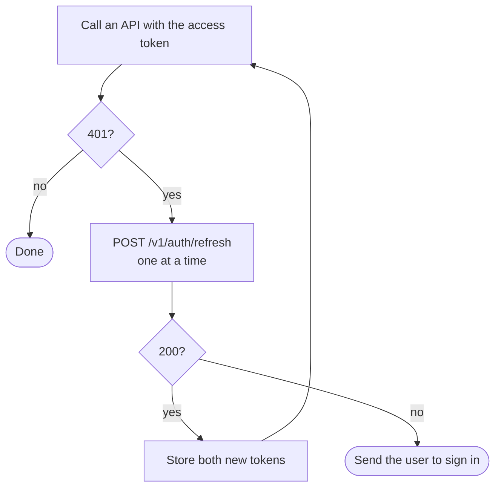

# Core: sign-in and tokens

The core is everything you get with `MODULES` empty. It is a complete authentication service on its own.

All examples assume `BASE=http://localhost:4000` and a JSON content type.

## Register and sign in

```bash
curl -s $BASE/v1/auth/register -H 'content-type: application/json' \
  -d '{"email":"ada@example.com","password":"correct horse battery staple"}'
```

```json
{
  "user": {
    "id": "7b0c...",
    "email": "ada@example.com",
    "isSuperuser": false,
    "attributes": {},
    "createdAt": "..."
  }
}
```

Passwords need at least 12 characters and must not be common, highly repetitive or based on the email address. There are no "one symbol, one digit" rules: length does more for security than composition.

```bash
curl -s $BASE/v1/auth/login -H 'content-type: application/json' \
  -d '{"email":"ada@example.com","password":"correct horse battery staple"}'
```

```json
{
  "mfaRequired": false,
  "accessToken": "eyJhbGciOiJFUzI1NiIs...",
  "refreshToken": "kZ3v...",
  "tokenType": "Bearer",
  "expiresIn": 900
}
```

## Using the tokens

Send the access token on each request:

```bash
curl -s $BASE/v1/auth/me -H "authorization: Bearer $ACCESS_TOKEN"
```

When it expires (15 minutes by default), trade the refresh token for a new pair:

```bash
curl -s $BASE/v1/auth/refresh -H 'content-type: application/json' \
  -d "{\"refreshToken\":\"$REFRESH_TOKEN\"}"
```

**Store the new refresh token and discard the old one.** Each refresh token works once. If your client ever sends an old one, Gatehouse assumes the token was stolen and ends the session (`401 refresh_token_reused`). In practice this means:

- Refresh from one place in your client, not from several requests in parallel.
- If a refresh response is lost to a network error, the user signs in again. That is the price of theft detection.

### Client pattern



### Where to keep tokens

| Client              | Access token                   | Refresh token                                                                                |
| ------------------- | ------------------------------ | -------------------------------------------------------------------------------------------- |
| Server-side web app | Server memory or session store | Server-side session store                                                                    |
| Single-page app     | Memory only                    | Prefer a small backend that holds it. If you must, memory, accepting a sign-in per page load |
| Mobile app          | Memory                         | The platform keystore (Keychain, Keystore)                                                   |

## Sessions

Each sign-in creates a session. Users can see and end them, which is what a "devices" screen needs:

```bash
curl -s $BASE/v1/auth/sessions -H "authorization: Bearer $ACCESS_TOKEN"
curl -s -X DELETE $BASE/v1/auth/sessions/$SESSION_ID -H "authorization: Bearer $ACCESS_TOKEN"
curl -s -X POST $BASE/v1/auth/logout -H "authorization: Bearer $ACCESS_TOKEN"
```

## Passwords

Changing a password needs the current one and signs out every other session:

```bash
curl -s $BASE/v1/auth/password/change -H "authorization: Bearer $ACCESS_TOKEN" \
  -H 'content-type: application/json' \
  -d '{"currentPassword":"correct horse battery staple","newPassword":"a brand new long passphrase"}'
```

Resetting a forgotten password is two steps:

```bash
curl -s $BASE/v1/auth/password/reset-request -H 'content-type: application/json' \
  -d '{"email":"ada@example.com"}'          # always 202

curl -s $BASE/v1/auth/password/reset -H 'content-type: application/json' \
  -d '{"token":"<from the email>","newPassword":"a brand new long passphrase"}'
```

Gatehouse does not send email itself. The reset token is handed to a `Notifier`:

```ts
const { app } = await buildApp({
  config,
  pool,
  notifier: {
    passwordReset: async (email, token) => {
      await mailer.send(email, `https://app.example.com/reset?token=${token}`);
    },
  },
});
```

The default notifier logs that a reset was requested. In development it also logs the token so you can try the flow; in production it never does.

## Lockout

After `MAX_FAILED_LOGINS` wrong passwords an account locks for `LOCKOUT_SECONDS`. Each further failure after the lock ends doubles the next lock, up to 64 times the base. A locked account gets the same `401 invalid_credentials` as a wrong password, so the lock itself reveals nothing. A correct sign-in after the lock expires clears the count.

## Superusers

A superuser passes every permission check. There is no endpoint that creates one:

```bash
pnpm cli grant-superuser ada@example.com
pnpm cli revoke-superuser ada@example.com
# in the container: node dist/cli.js grant-superuser ada@example.com
```

## Rotating the signing key

```bash
curl -s -X POST $BASE/v1/admin/keys/rotate -H "authorization: Bearer $ADMIN_TOKEN"
# => { "kid": "..." }
```

New tokens are signed with the new key from that moment. Tokens signed by the old key keep verifying until they expire, so nobody is signed out.

## Error codes

| Status | Code                    | Meaning                                                                   |
| ------ | ----------------------- | ------------------------------------------------------------------------- |
| 400    | `validation_error`      | Malformed request. See `details.issues`                                   |
| 400    | `invalid_token`         | A reset token, MFA token, OAuth state or code is unknown, used or expired |
| 401    | `invalid_credentials`   | Sign-in failed                                                            |
| 401    | `unauthenticated`       | Missing, invalid or expired access token, or its session has ended        |
| 401    | `invalid_refresh_token` | Unknown or expired refresh token                                          |
| 401    | `refresh_token_reused`  | A used refresh token was presented. The session is over                   |
| 403    | `forbidden`             | Signed in, but not allowed. See `details.permission`                      |
| 404    | `not_found`             | No such thing, or the module is not enabled                               |
| 409    | `email_taken`           | Registration with an existing email                                       |
| 422    | `weak_password`         | The password does not meet the policy                                     |
| 429    | `rate_limited`          | Slow down                                                                 |
