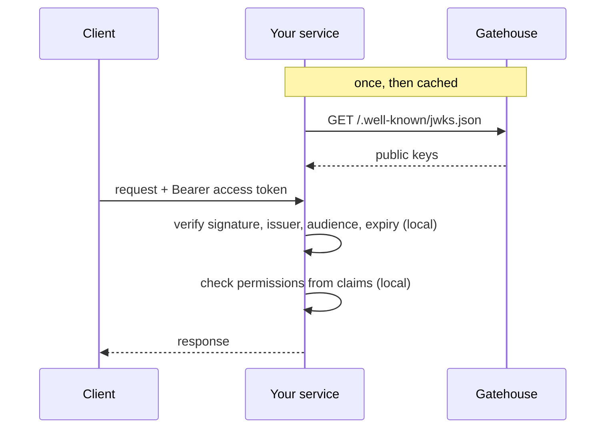

# Integrating a service

How an API of yours accepts Gatehouse tokens.



There is no call to Gatehouse on the request path. Your service needs the issuer URL and nothing secret.

## Verify the token

### Node.js

```ts
import { createRemoteJWKSet, jwtVerify, type JWTPayload } from 'jose';

const ISSUER = process.env.AUTH_ISSUER!; // https://auth.example.com
const AUDIENCE = process.env.AUTH_AUDIENCE ?? 'gatehouse';

// Fetches the keys on first use, caches them, and refetches when it meets a
// key id it has not seen, which is what makes key rotation seamless.
const keys = createRemoteJWKSet(new URL(`${ISSUER}/.well-known/jwks.json`));

export interface AccessClaims extends JWTPayload {
  sub: string;
  sid: string;
  email: string;
  roles?: string[];
  permissions?: string[];
}

export async function verifyAccessToken(token: string): Promise<AccessClaims> {
  const { payload } = await jwtVerify(token, keys, {
    issuer: ISSUER,
    audience: AUDIENCE,
    algorithms: ['ES256'],
  });
  return payload as AccessClaims;
}
```

As Express middleware:

```ts
export async function authenticate(req, res, next) {
  const header = req.headers.authorization ?? '';
  if (!header.startsWith('Bearer ')) return res.status(401).end();
  try {
    req.user = await verifyAccessToken(header.slice(7));
    next();
  } catch {
    res.status(401).end();
  }
}
```

### Python

```python
import jwt  # PyJWT, with the "crypto" extra

ISSUER = "https://auth.example.com"
jwks = jwt.PyJWKClient(f"{ISSUER}/.well-known/jwks.json")

def verify_access_token(token: str) -> dict:
    key = jwks.get_signing_key_from_jwt(token)
    return jwt.decode(
        token,
        key.key,
        algorithms=["ES256"],
        issuer=ISSUER,
        audience="gatehouse",
    )
```

## The three checks you must not skip

1. **Algorithm.** Pin `ES256`. A verifier that trusts the token's own `alg` header can be talked into accepting an unsigned token.
2. **Issuer.** So a token from some other system with a key you happen to trust is not accepted.
3. **Audience.** So a token minted for a different purpose is not accepted. Gatehouse's MFA tokens, for example, are signed by the same key with a different audience.

Expiry is checked by every library by default. Leave it on.

## What is in a token

```json
{
  "iss": "https://auth.example.com",
  "aud": "gatehouse",
  "sub": "7b0c0d2e-...",
  "sid": "3f6a91c4-...",
  "email": "ada@example.com",
  "roles": ["editor"],
  "permissions": ["articles:read", "articles:write"],
  "iat": 1794391200,
  "exp": 1794392100
}
```

`roles` and `permissions` are present only with the `rbac` module. Identify users by `sub`, never by `email`, which can change.

## How fresh is it?

A token is a snapshot from when it was issued. For up to `ACCESS_TOKEN_TTL_SECONDS` (15 minutes) after a change, a token may still:

- carry a role that has since been removed
- belong to a session that has since been signed out

For most requests that is the right trade for not calling the auth service every time. For the few where it is not, ask Gatehouse, forwarding the user's token:

```ts
async function allowed(userToken: string, permission: string): Promise<boolean> {
  const response = await fetch(`${ISSUER}/v1/authz/check`, {
    method: 'POST',
    headers: { authorization: `Bearer ${userToken}`, 'content-type': 'application/json' },
    body: JSON.stringify({ permission }),
  });
  if (response.status === 401) return false; // session ended
  return ((await response.json()) as { allowed: boolean }).allowed;
}
```

That one call checks the session is still alive and reads current roles. For attribute-based decisions use `/v1/authz/evaluate` the same way ([Policies](abac.md)).

## Key rotation

You do nothing. A new key appears in the JWKS, tokens start arriving with its `kid`, and JWKS clients fetch the updated set when they see a `kid` they do not know. The old key stays published until the last token it signed has expired.

If you cache the JWKS yourself, refetch on an unknown `kid` and do not cache for longer than a few minutes.

## Checklist

- [ ] Algorithm pinned to ES256
- [ ] Issuer and audience checked
- [ ] Users identified by `sub`
- [ ] Authorization enforced on the server, never only in the UI
- [ ] Sensitive operations confirmed with `/v1/authz/check` or `/v1/authz/evaluate`
- [ ] Tokens never logged
