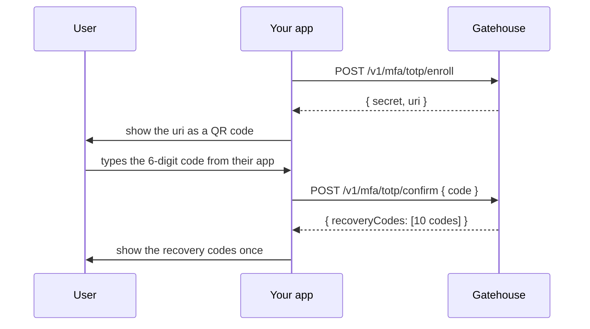

# Two-factor authentication (`mfa`)

Enable with `MODULES=mfa`.

Adds time-based one-time passwords (TOTP, RFC 6238): the six-digit codes from Google Authenticator, 1Password, Authy and the like. Two-factor is opt-in per user. Once a user turns it on, a password alone no longer signs them in.

## Turning it on



```bash
curl -s -X POST $BASE/v1/mfa/totp/enroll -H "authorization: Bearer $ACCESS_TOKEN"
# => { "secret": "JBSWY3DPEHPK3PXP...", "uri": "otpauth://totp/..." }

curl -s $BASE/v1/mfa/totp/confirm -H "authorization: Bearer $ACCESS_TOKEN" \
  -H 'content-type: application/json' -d '{"code":"492039"}'
# => { "recoveryCodes": ["k3v9...", ...] }
```

Render `uri` as a QR code in your app. Nothing is enforced until the confirm step succeeds, so a user who abandons setup is not locked out.

The ten recovery codes are shown once and stored only as hashes. Tell the user to save them: each one signs them in once if they lose their device.

## Signing in

With two-factor on, sign-in takes two steps.

```bash
curl -s $BASE/v1/auth/login -H 'content-type: application/json' \
  -d '{"email":"ada@example.com","password":"correct horse battery staple"}'
# => { "mfaRequired": true, "mfaToken": "eyJ...", "methods": ["totp"] }

curl -s $BASE/v1/auth/mfa/verify -H 'content-type: application/json' \
  -d '{"mfaToken":"eyJ...","code":"492039"}'
# => { "mfaRequired": false, "accessToken": "...", "refreshToken": "..." }
```

Always branch on `mfaRequired` in your sign-in code, even if you have not enabled the module yet. The `mfaToken` lasts five minutes and is accepted only by the verify endpoint.

To use a recovery code, send `recoveryCode` instead of `code`:

```bash
curl -s $BASE/v1/auth/mfa/verify -H 'content-type: application/json' \
  -d '{"mfaToken":"eyJ...","recoveryCode":"k3v9..."}'
```

The same challenge applies to OAuth sign-ins when both modules are on. The session records how the user got in (`password+totp`, `oauth:google+totp`, `password+recovery_code`), visible in `GET /v1/auth/sessions`.

## Turning it off

```bash
curl -s $BASE/v1/mfa/totp/disable -H "authorization: Bearer $ACCESS_TOKEN" \
  -H 'content-type: application/json' -d '{"code":"492039"}'
```

A current code is required, so a stolen access token is not enough to strip the second factor. A user who has lost both their device and their recovery codes needs an administrator to clear it:

```sql
DELETE FROM mfa_totp WHERE user_id = $1;
DELETE FROM mfa_recovery_codes WHERE user_id = $1;
```

Verify the person's identity out of band before you do.

## Details

- Codes are six digits, 30-second steps, SHA-1, the parameters every authenticator app supports.
- One step either side of the current time is accepted, to allow for clock drift.
- Each code is accepted once. A code seen over someone's shoulder cannot be replayed, even inside its 30 seconds.
- Secrets are encrypted at rest with `KEY_ENCRYPTION_KEY`.
- A wrong code answers `422 invalid_mfa_code`.
