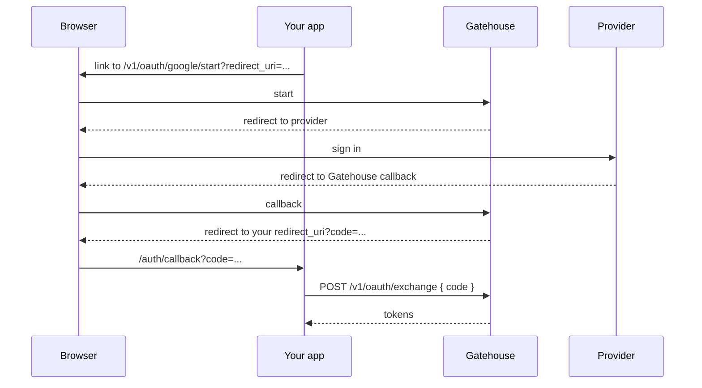

# OAuth sign-in (`oauth`)

Enable with `MODULES=oauth`.

Lets users sign in with an account they already have at any provider that speaks OAuth 2.0 authorization code flow and has a userinfo endpoint: Google, GitHub, Microsoft, GitLab, Okta, Auth0, Keycloak and so on. Whichever provider they use, your services still receive Gatehouse tokens, so nothing downstream changes.

## Configure a provider

1. Register an application with the provider. Set its redirect (callback) URL to:

   ```
   <ISSUER>/v1/oauth/<provider-id>/callback
   ```

   For example `https://auth.example.com/v1/oauth/google/callback`.

2. Describe the provider in `OAUTH_PROVIDERS`, a JSON array:

   ```bash
   OAUTH_PROVIDERS='[{
     "id": "google",
     "clientId": "1234.apps.googleusercontent.com",
     "clientSecret": "...",
     "authorizationUrl": "https://accounts.google.com/o/oauth2/v2/auth",
     "tokenUrl": "https://oauth2.googleapis.com/token",
     "userInfoUrl": "https://openidconnect.googleapis.com/v1/userinfo",
     "scopes": ["openid", "email", "profile"]
   }]'
   ```

   `scopes` defaults to `["openid", "email", "profile"]`.

3. List the URLs in **your app** that a browser may be sent back to:

   ```bash
   OAUTH_REDIRECT_ALLOWLIST=https://app.example.com/auth/callback,http://localhost:3000/auth/callback
   ```

   Matches are exact. There are no wildcards, because a loose match here is how one-time codes get delivered to attackers.

The userinfo response must contain `sub` (or `id`), `email`, and `email_verified: true`. Providers that do not report a verified email cannot create accounts. They can still be linked to an existing account (below).

## The flow from your app



**1. Send the browser to start.** A plain link or redirect:

```
GET /v1/oauth/google/start?redirect_uri=https%3A%2F%2Fapp.example.com%2Fauth%2Fcallback
```

**2. Handle the return.** The browser arrives at your `redirect_uri` with one of:

```
https://app.example.com/auth/callback?code=Qm9f...      success
https://app.example.com/auth/callback?error=...          failure
```

**3. Exchange the code**, within 60 seconds, once:

```bash
curl -s $BASE/v1/oauth/exchange -H 'content-type: application/json' -d '{"code":"Qm9f..."}'
# => the same response as password sign-in: tokens, or an MFA challenge
```

### Errors on return

| `error`              | Meaning                                               | What to show                                                      |
| -------------------- | ----------------------------------------------------- | ----------------------------------------------------------------- |
| `access_denied`      | The user cancelled at the provider                    | Nothing, or "sign-in cancelled"                                   |
| `provider_error`     | The provider rejected the code or was unreachable     | "Try again"                                                       |
| `email_not_verified` | The provider did not confirm the email                | "Verify your email with the provider first"                       |
| `account_exists`     | A Gatehouse account already uses that email           | "Sign in with your password, then link this provider in settings" |
| `identity_in_use`    | Linking: the provider account belongs to another user | "That account is linked to a different user"                      |

## Why accounts are not merged by email

If `ada@example.com` already has a password account and someone signs in through a provider reporting the same email, Gatehouse answers `account_exists` and does not sign them in.

Merging automatically looks friendly but is a known account takeover route: it trusts every configured provider to have verified that address properly, forever, and it lets someone who registered a victim's email first inherit the victim's later provider sign-in. Instead, the owner of the account links the provider themselves.

## Linking a provider to a signed-in user

```bash
curl -s $BASE/v1/oauth/google/link -H "authorization: Bearer $ACCESS_TOKEN" \
  -H 'content-type: application/json' \
  -d '{"redirect_uri":"https://app.example.com/auth/callback"}'
# => { "url": "https://accounts.google.com/o/oauth2/v2/auth?..." }
```

Navigate the browser to `url`. After the provider, the browser returns to your `redirect_uri` with a `code` as usual. From then on, signing in through that provider lands in this account.

This is a `POST` that returns a URL, and not a redirect, because a browser navigation cannot carry a bearer token.

## What Gatehouse does for you

- Generates and checks `state`, so a callback can only finish a sign-in this service started.
- Uses PKCE (S256) on every flow, including with confidential clients.
- Keeps the provider's tokens to itself. They are used once to read the profile and then discarded.
- Never puts its own tokens in a URL.
- Lists providers at `GET /v1/oauth/providers` (ids only) so your sign-in page can render the right buttons.
