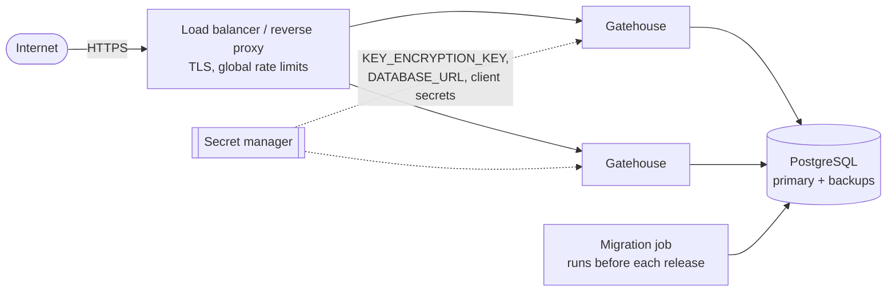

# Running in production

## Topology



Instances are stateless and interchangeable. Run at least two.

## Before you go live

1. **TLS in front, always.** Gatehouse speaks plain HTTP and expects a proxy to terminate TLS. With `NODE_ENV=production` it trusts `X-Forwarded-For` for client IPs, so it must be reachable only through that proxy.
2. **`ISSUER` is the public HTTPS URL**, for example `https://auth.example.com`. It goes into every token and into OAuth callback URLs. Changing it later invalidates outstanding tokens.
3. **Generate a `KEY_ENCRYPTION_KEY`** and store it in your secret manager:

   ```bash
   pnpm cli generate-key
   ```

   Back it up separately from the database. Losing it means signing keys and TOTP secrets cannot be decrypted: every user is signed out and two-factor users must re-enrol. An attacker needs both the database and this key to mint tokens.

4. **A dedicated database and role.** The role needs ordinary read and write on its own tables. It does not need superuser.
5. **Implement the `Notifier`** so password reset emails are delivered ([Core](core.md#passwords)).
6. **Set `CORS_ORIGINS`** if browsers call Gatehouse directly. List exact origins.
7. **Enable `audit`** and route alerts ([Audit log](audit.md#what-to-alert-on)).
8. **Create the first superuser** from a trusted shell: `node dist/cli.js grant-superuser you@example.com`.

## Deploying

The image is built from the `Dockerfile`: a multi-stage build that ships production dependencies only and runs as an unprivileged user.

Run migrations as a separate step before starting the new version:

```bash
docker run --rm -e DATABASE_URL=... gatehouse node dist/db/migrate.js
docker run -d -p 4000:4000 --env-file gatehouse.env gatehouse
```

Migrations are plain SQL files applied in order, each in a transaction, and recorded so they run once. Never edit one that has been released. Add a new one.

### Probes

| Endpoint       | Use as    | Meaning                                               |
| -------------- | --------- | ----------------------------------------------------- |
| `GET /healthz` | Liveness  | The process is up                                     |
| `GET /readyz`  | Readiness | The database is reachable. Also lists enabled modules |

### Changing modules

Changing `MODULES` is a restart, not a migration. Every module's tables always exist.

- **Turning one on** takes effect at the next sign-in. `rbac` claims appear in tokens issued from then on.
- **Turning one off** removes its endpoints and its effect on sign-in, and keeps its data. Turning `mfa` off means users with two-factor sign in with a password alone again, so treat that as a security change, not a config tweak.

## Operating

### Rotate signing keys

Rotate on a schedule (every 90 days is a reasonable start) and at once if a key may have been exposed:

```bash
curl -X POST https://auth.example.com/v1/admin/keys/rotate -H "authorization: Bearer $ADMIN_TOKEN"
```

Nobody is signed out. If a key was actually compromised, rotating is not enough, because tokens the attacker already minted stay valid until they expire and the retired key keeps verifying for one token lifetime. In that case also delete the retired key so its tokens stop verifying immediately:

```sql
DELETE FROM signing_keys WHERE retired_at IS NOT NULL;
```

Users with tokens signed by it will refresh and carry on.

### Respond to a stolen account

```sql
-- End every session of one user
UPDATE sessions SET revoked_at = now(), revoked_reason = 'incident' WHERE user_id = $1 AND revoked_at IS NULL;
-- Stop them signing in at all
UPDATE users SET disabled_at = now() WHERE id = $1;
```

Then have the user reset their password, which also ends every session.

### Housekeeping

Expired rows are harmless but accumulate. Run this daily:

```sql
DELETE FROM refresh_tokens WHERE expires_at < now() - interval '7 days';
DELETE FROM sessions WHERE revoked_at < now() - interval '30 days';
DELETE FROM password_resets WHERE expires_at < now() - interval '1 day';
DELETE FROM oauth_states WHERE expires_at < now();
DELETE FROM oauth_exchange_codes WHERE expires_at < now();
DELETE FROM signing_keys WHERE verify_until < now();
```

### Logs

Structured JSON on stdout, one line per request, each with a `reqId` that is also returned as `x-request-id`. `Authorization` and `Cookie` headers are redacted. Ship them to your log system and keep the request id in support tickets.

### Tuning

| Setting                                                | When to change it                                                                                                  |
| ------------------------------------------------------ | ------------------------------------------------------------------------------------------------------------------ |
| `PASSWORD_HASH_MEMORY_KIB`, `PASSWORD_HASH_ITERATIONS` | Raise until one hash takes roughly 100 to 250 ms on your hardware. The defaults are the OWASP minimum for Argon2id |
| `ACCESS_TOKEN_TTL_SECONDS`                             | Lower to shrink the window in which a stolen token or stale role is honoured, at the cost of more refreshes        |
| `AUTH_RATE_LIMIT_MAX`                                  | Raise if many legitimate users share one IP (offices, carrier NAT)                                                 |
| `DATABASE_POOL_MAX`                                    | Keep instances times pool size under the database's connection limit                                               |

## Known limits

Read [What is not defended](../threat-model.md#what-is-not-defended) before launch. The ones that most often need work first: email delivery and verification, rate limiting at the edge when running several instances, and a per-account limit on second-factor attempts.
