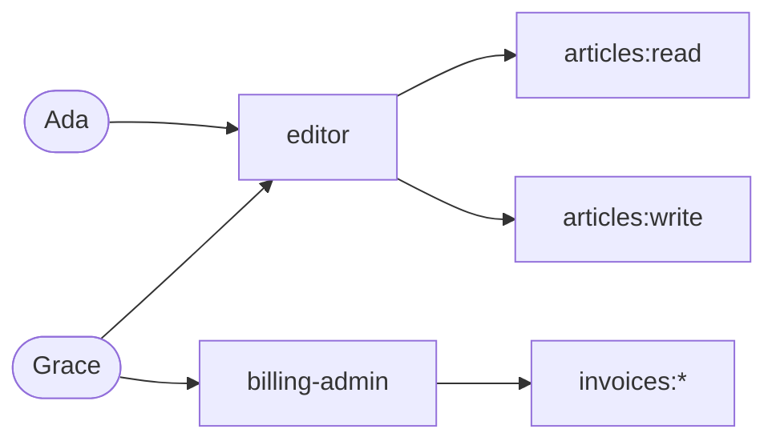

# Roles and permissions (`rbac`)

Enable with `MODULES=rbac`.

Role-based access control answers "what is this user allowed to do?" with a list of permissions that come from the roles they hold.



## Permissions

A permission is a colon-separated string, most general part first: `articles:read`, `invoices:refunds:create`. You choose the vocabulary. A role may grant a wildcard:

| Granted         | Covers                                     | Does not cover             |
| --------------- | ------------------------------------------ | -------------------------- |
| `invoices:read` | `invoices:read`                            | `invoices:write`           |
| `invoices:*`    | `invoices:read`, `invoices:refunds:create` | `payroll:read`, `invoices` |
| `*`             | everything                                 |                            |

## Managing roles

These endpoints need a superuser or the `auth:roles:manage` permission.

```bash
# Create or replace a role
curl -s -X PUT $BASE/v1/roles/editor -H "authorization: Bearer $ADMIN_TOKEN" \
  -H 'content-type: application/json' \
  -d '{"description":"Writes articles","permissions":["articles:read","articles:write"]}'

# Give it to a user
curl -s -X PUT $BASE/v1/users/$USER_ID/roles/editor -H "authorization: Bearer $ADMIN_TOKEN"

# See what a user ends up with
curl -s $BASE/v1/users/$USER_ID/roles -H "authorization: Bearer $ADMIN_TOKEN"
# => { "roles": ["editor"], "permissions": ["articles:read", "articles:write"] }

# Take it away, or delete the role for everyone
curl -s -X DELETE $BASE/v1/users/$USER_ID/roles/editor -H "authorization: Bearer $ADMIN_TOKEN"
curl -s -X DELETE $BASE/v1/roles/editor -H "authorization: Bearer $ADMIN_TOKEN"
```

## Enforcing permissions

You have two options. Use the first by default and the second where staleness matters.

### 1. From the token (fast, up to one token lifetime stale)

With `rbac` on, every access token carries the user's roles and permissions:

```json
{
  "sub": "7b0c...",
  "sid": "...",
  "email": "ada@example.com",
  "roles": ["editor"],
  "permissions": ["articles:read", "articles:write"]
}
```

Your service verifies the token ([Integrating a service](integrating-a-service.md)) and checks the claim. No network call.

```ts
function covers(granted: string, required: string): boolean {
  if (granted === '*' || granted === required) return true;
  return granted.endsWith(':*') && required.startsWith(granted.slice(0, -1));
}

export function requirePermission(required: string) {
  return (request, reply, next) => {
    const granted: string[] = request.token.permissions ?? [];
    if (granted.some((permission) => covers(permission, required))) return next();
    reply.status(403).send({ error: 'forbidden' });
  };
}
```

A role change shows up in the user's next token, at most `ACCESS_TOKEN_TTL_SECONDS` later.

### 2. Ask Gatehouse (always current)

```bash
curl -s $BASE/v1/authz/check -H "authorization: Bearer $USER_TOKEN" \
  -H 'content-type: application/json' -d '{"permission":"articles:write"}'
# => { "allowed": true }
```

This reads the database, so a role removed a second ago is already gone. Use it for operations where a 15-minute window is too long: payouts, deleting data, changing access.

## Delegating administration

Gatehouse's own administrative endpoints are guarded by ordinary permissions, so you can hand out parts of administration without making someone a superuser:

| Permission             | Allows                            |
| ---------------------- | --------------------------------- |
| `auth:roles:manage`    | Managing roles and who holds them |
| `auth:policies:manage` | Managing `abac` policies          |
| `auth:audit:read`      | Reading the audit log             |
| `auth:keys:rotate`     | Rotating the signing key          |

These are always checked against the database, never the token.

Be careful with `auth:roles:manage`: someone who can edit roles can grant themselves any other permission. Give it only to people you would trust with full administration.
