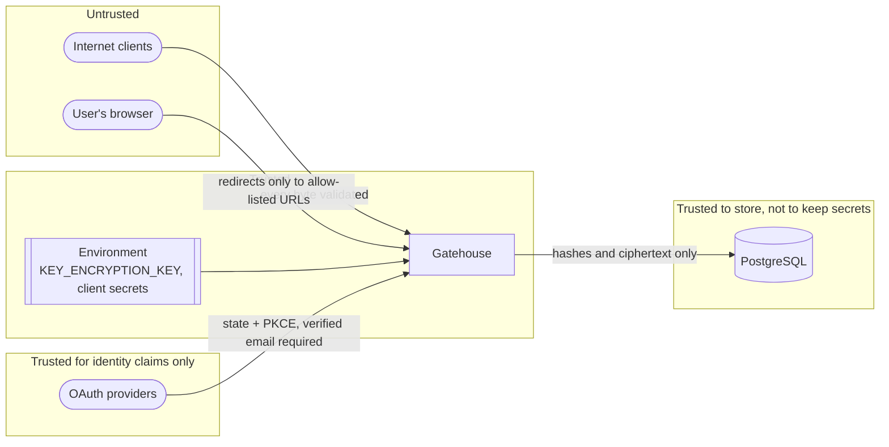

# Threat model

No authentication system is hack proof, and anything that says so should not be trusted. What a system can do is state what it protects, who it expects to attack it, how each attack is met, and what it leaves to you. This document does that for Gatehouse.

Each defence below names the test that proves it. If you change the code and a defence stops holding, that test fails.

- [What is protected](#what-is-protected)
- [Who attacks it](#who-attacks-it)
- [Trust boundaries](#trust-boundaries)
- [Threats and defences](#threats-and-defences)
- [What is not defended](#what-is-not-defended)
- [Your responsibilities as an operator](#your-responsibilities-as-an-operator)

## What is protected

| Asset                                | Why it matters                                                 |
| ------------------------------------ | -------------------------------------------------------------- |
| User passwords                       | Reused across sites. A leak harms users far beyond this system |
| Signing keys                         | Whoever holds one can mint a valid token for any user          |
| Sessions and refresh tokens          | Long-lived access to an account                                |
| TOTP secrets and recovery codes      | The second factor is only as secret as these                   |
| Roles, policies and superuser status | They decide what every user can do                             |
| The audit log                        | The record you rely on after an incident                       |

## Who attacks it

1. **An anonymous attacker on the internet.** Can send any request to any endpoint, at volume, and can read anything public.
2. **A signed-in user** trying to gain permissions they were not given, or to reach another user's account.
3. **Someone who has stolen a token**, from a device, a log, a proxy or a browser.
4. **Someone who has stolen a copy of the database**, through a backup, an injection elsewhere or a misconfigured replica.
5. **A malicious website** the victim visits while signed in, or a link the victim is tricked into clicking.

Out of scope: an attacker with code execution on the Gatehouse host or with both the database and `KEY_ENCRYPTION_KEY`. At that point the service itself is compromised.

## Trust boundaries

The database is treated as something that may one day be read by an attacker. Nothing in it is enough, on its own, to sign in as a user or mint a token.

## Threats and defences

### Credentials

| #   | Threat                                  | Defence                                                                                                                                                                                | Proven by                                                                                                  |
| --- | --------------------------------------- | -------------------------------------------------------------------------------------------------------------------------------------------------------------------------------------- | ---------------------------------------------------------------------------------------------------------- |
| C1  | Database theft exposes passwords        | Argon2id with a per-password salt. The plaintext is never stored or logged                                                                                                             | `auth.test.ts`: stores an Argon2id hash, not the password                                                  |
| C2  | Online password guessing                | Per-IP rate limit of 20 per minute on sign-in endpoints. After 5 failures the account locks for 15 minutes, doubling with each further failure up to 64 times                          | `auth.test.ts`: locks the account after repeated failures                                                  |
| C3  | Lockout used to deny service forever    | Locks always expire and a correct sign-in clears the count. There is no permanent lock                                                                                                 | `auth.test.ts`: unlocks once the lock expires                                                              |
| C4  | Finding out which emails have accounts  | Sign-in gives one answer for wrong password, unknown email, locked and disabled, and does a full hash verification in every case so timing matches. Reset requests always answer `202` | `auth.test.ts`: same answer for a wrong password and an unknown email; answers a reset request identically |
| C5  | Weak passwords                          | Minimum 12 characters, a common-password list, no highly repetitive passwords, no passwords built on the email. No composition rules, following NIST SP 800-63B                        | `password-policy.test.ts`                                                                                  |
| C6  | Hash computation as a denial of service | Passwords over 128 characters are rejected before hashing. Request bodies are capped at 64 KiB                                                                                         | `password-policy.test.ts`                                                                                  |
| C7  | Stolen reset link reused                | Reset tokens are random, stored hashed, valid for 30 minutes and single-use. A reset ends every session                                                                                | `auth.test.ts`: resets the password with a one-time token                                                  |

### Tokens and sessions

| #   | Threat                                   | Defence                                                                                                                              | Proven by                                                                           |
| --- | ---------------------------------------- | ------------------------------------------------------------------------------------------------------------------------------------ | ----------------------------------------------------------------------------------- |
| T1  | Forging a token                          | ES256 signatures. The private key exists only inside Gatehouse                                                                       | `auth.test.ts`: rejects a token signed by someone else                              |
| T2  | `alg: none` and algorithm confusion      | The verifier accepts ES256 and nothing else, whatever the token header says                                                          | `auth.test.ts`: rejects an unsigned token                                           |
| T3  | A token for one audience used at another | Issuer and audience are checked. The MFA token uses its own audience                                                                 | `mfa.test.ts`: does not accept the MFA token as an access token, and the reverse    |
| T4  | Stolen refresh token                     | Single-use rotation. A replay ends the session for everyone and emits `token.reuse_detected`                                         | `auth.test.ts`: ends the whole session when a used refresh token is presented again |
| T5  | Racing two refreshes to fork a session   | The token row is locked for the check and the update                                                                                 | `auth.test.ts`: lets only one of two racing refreshes succeed                       |
| T6  | Database theft exposes refresh tokens    | Only SHA-256 hashes are stored. Tokens are 256 bits of randomness, so the hash cannot be reversed by guessing                        | `auth.test.ts`: stores only a hash of the refresh token                             |
| T7  | A stolen access token outlives sign-out  | Gatehouse checks the session on each of its own requests. For other services the exposure is at most the token lifetime (15 minutes) | `auth.test.ts`: stop working the moment the session is signed out                   |
| T8  | Database theft exposes signing keys      | Private keys are encrypted with AES-256-GCM under a key held in the environment. Tampered ciphertext fails to decrypt                | `auth.test.ts`: stores private keys encrypted; `secretbox.test.ts`                  |
| T9  | A leaked signing key stays valid forever | Keys can be rotated at any time without signing users out. The JWKS never contains private material                                  | `auth.test.ts`: signing key rotation; published keys contain no private material    |
| T10 | Tokens cached by browsers or proxies     | Every response is `cache-control: no-store`, except the public JWKS                                                                  | `auth.test.ts`: sign-in returns `no-store`                                          |

### Authorization

| #   | Threat                                       | Defence                                                                                                                                                   | Proven by                                                                 |
| --- | -------------------------------------------- | --------------------------------------------------------------------------------------------------------------------------------------------------------- | ------------------------------------------------------------------------- |
| A1  | Registering as an administrator              | Bodies are strict: an unexpected field such as `isSuperuser` is a `400`. Superusers are made only by the CLI, which needs database access                 | `auth.test.ts`: rejects unknown fields                                    |
| A2  | Acting on another user's session             | Session operations are scoped to the caller. Another user's session id answers `404`                                                                      | `auth.test.ts`: does not let a user end someone else's session            |
| A3  | Using a revoked role until the token expires | Administrative endpoints and `/v1/authz/check` read roles from the database on every request                                                              | `rbac.test.ts`: takes effect at once when a role is removed               |
| A4  | A wildcard permission reaching too far       | `invoices:*` matches only under `invoices:`. Only a bare `*` matches everything                                                                           | `permissions.test.ts`; `rbac.test.ts`: wildcards within a namespace only  |
| A5  | Claiming attributes you do not have          | The policy subject is built from the verified token and the database. A `subject` in the request is rejected                                              | `abac.test.ts`: reads subject attributes from the server, not the request |
| A6  | A buggy policy granting access               | Default deny, deny overrides allow, and a condition that cannot be evaluated is false                                                                     | `abac.test.ts`: fails closed; `abac.test.ts` (unit)                       |
| A7  | Policy conditions as a code injection path   | Conditions are data, checked against a fixed set of operators. Variables can only start at `subject`, `resource` or `context`. Depth and size are bounded | `abac.test.ts`: rejects unknown operators or variable roots               |
| A8  | Delegated admins exceeding their brief       | Each administrative area has its own permission. Managing roles does not let you rotate keys or read the audit log                                        | `rbac.test.ts`: delegated administration                                  |

Note on A8: a user with `auth:roles:manage` can create a role containing any permission, including the other administrative ones, and assign it to themselves. Treat `auth:roles:manage` as equivalent to full administration when deciding who gets it.

### OAuth

| #   | Threat                                                                  | Defence                                                                                             | Proven by                                                                       |
| --- | ----------------------------------------------------------------------- | --------------------------------------------------------------------------------------------------- | ------------------------------------------------------------------------------- |
| O1  | Login CSRF: the victim's browser completes a login the attacker started | A random `state`, stored hashed, valid for 10 minutes and deleted on first use                      | `oauth.test.ts`: accepts a state once only; rejects a state it did not issue    |
| O2  | Authorization code interception                                         | PKCE with S256. The code is useless without the verifier, which never leaves Gatehouse              | `oauth.test.ts`: the fake provider refuses a code without the matching verifier |
| O3  | Open redirect, sending the one-time code to an attacker                 | `redirect_uri` must match the allow-list exactly. No prefixes, no wildcards                         | `oauth.test.ts`: refuses a redirect_uri that is not on the allow-list           |
| O4  | Tokens leaking through URLs                                             | The browser receives a 60-second, single-use code. Tokens are returned only in the body of a `POST` | `oauth.test.ts`: hands tokens over only through a one-time code                 |
| O5  | Account takeover by registering the victim's email at a provider        | An existing account is never matched by email. Linking needs the user to be signed in already       | `oauth.test.ts`: never takes over a local account that has the same email       |
| O6  | Pre-registration with an unverified email                               | A provider must report `email_verified: true` before an account is created                          | `oauth.test.ts`: does not create an account from an unverified email            |
| O7  | One provider identity attached to two accounts                          | A linked identity cannot be claimed by a second user                                                | `oauth.test.ts`: does not let a second user claim an identity                   |
| O8  | Client secret exposure                                                  | Sent only to the provider's token endpoint, server to server. Never returned by any endpoint        | `oauth.test.ts`: lists providers without their secrets                          |

### Two-factor

| #   | Threat                                    | Defence                                                                                               | Proven by                                                 |
| --- | ----------------------------------------- | ----------------------------------------------------------------------------------------------------- | --------------------------------------------------------- |
| M1  | Skipping the second step                  | After the password, no session exists. Only the MFA token is issued, and no other endpoint accepts it | `mfa.test.ts`: issues no session after the password alone |
| M2  | Replaying an observed code                | Each time step is accepted once per user                                                              | `mfa.test.ts`: accepts each code once                     |
| M3  | Guessing the six digits                   | The verify endpoint is rate limited per IP, and the MFA token lasts five minutes                      | Rate limit configuration. See the residual risk below     |
| M4  | Database theft exposes TOTP secrets       | Secrets are AES-256-GCM encrypted. Recovery codes are stored hashed                                   | `mfa.test.ts`: stores the secret encrypted                |
| M5  | A stolen access token disables two-factor | Disabling needs a current code                                                                        | `mfa.test.ts`: can be turned off with a valid code        |
| M6  | Lockout through a half-finished setup     | Nothing is enforced until a code is confirmed                                                         | `mfa.test.ts`: enforces nothing until confirmed           |

### Transport, input and operations

| #   | Threat                                   | Defence                                                                                                                                                   | Proven by                                                |
| --- | ---------------------------------------- | --------------------------------------------------------------------------------------------------------------------------------------------------------- | -------------------------------------------------------- |
| X1  | SQL injection                            | Every query is parameterised. No SQL is built from input                                                                                                  | Code review; CodeQL on every push                        |
| X2  | Malformed or oversized input             | Zod schemas on every body, query and path. 64 KiB body limit                                                                                              | Validation tests in every suite                          |
| X3  | Clickjacking, sniffing, downgrade        | Helmet sets CSP, `X-Frame-Options`, `nosniff` and HSTS                                                                                                    | Verified against the running container                   |
| X4  | Cross-origin abuse from a malicious site | CORS is off unless origins are listed. Tokens travel in the `Authorization` header, not cookies, so a cross-site request carries no credentials (no CSRF) | Configuration                                            |
| X5  | Secrets in logs                          | `Authorization` and `Cookie` headers are redacted. Passwords and tokens are never logged. Reset tokens are logged only in development                     | `audit.test.ts`: never records a password, token or code |
| X6  | Covering tracks                          | `UPDATE` and `DELETE` on the audit log raise an error in the database itself                                                                              | `audit.test.ts`: cannot be edited or deleted             |
| X7  | Vulnerable dependencies                  | `pnpm audit` in CI, Dependabot weekly, CodeQL. Eleven direct runtime dependencies                                                                         | CI                                                       |
| X8  | Container escape made easier             | The image runs as an unprivileged user and contains no build tooling or dev dependencies                                                                  | Dockerfile                                               |
| X9  | Error messages leaking internals         | Unexpected errors return a bare `500` and are logged server-side with the request id                                                                      | App error handler                                        |

## What is not defended

These are real gaps. Some are deliberate scope limits, some are the next things to build.

| Gap                                                                    | Consequence                                                                                            | What to do                                                                                                                                |
| ---------------------------------------------------------------------- | ------------------------------------------------------------------------------------------------------ | ----------------------------------------------------------------------------------------------------------------------------------------- |
| **Registration reveals whether an email is taken** (`409 email_taken`) | C4 holds for sign-in and reset, not for sign-up                                                        | Rate limiting slows harvesting. To close it fully, always answer `202` and send the result by email, which needs the mail transport below |
| **No email verification, and no mail transport**                       | Anyone can register an address they do not own. Reset tokens are handed to a `Notifier` that only logs | Implement `Notifier` for your mail provider before going live, and add a verification step                                                |
| **Access tokens cannot be revoked at other services**                  | After sign-out a stolen access token works at resource servers until it expires                        | Keep the lifetime short. For sensitive operations call `/v1/authz/check`, or have services check session status                           |
| **TOTP guessing is limited per IP, not per account**                   | A distributed attacker who already has the password gets more guesses than one IP would                | Add a per-user failure counter on the MFA step, as sign-in has                                                                            |
| **Rate limits are per process**                                        | With several instances the effective limit multiplies                                                  | Enforce limits at a shared edge (load balancer, API gateway)                                                                              |
| **No rotation tooling for `KEY_ENCRYPTION_KEY`**                       | Replacing it means re-encrypting stored keys and TOTP secrets by hand                                  | The ciphertext is versioned (`v1.`) so a re-encryption command can be added                                                               |
| **No phishing-resistant factor**                                       | TOTP codes can be relayed by a real-time phishing page                                                 | Add WebAuthn or passkeys as another module                                                                                                |
| **Compromised client device**                                          | Malware or XSS in your app can read tokens the app holds                                               | Out of Gatehouse's reach. Use a strict CSP in your app and keep tokens out of `localStorage` where you can                                |
| **Provider compromise**                                                | Gatehouse believes what a configured OAuth provider says                                               | Configure only providers you trust                                                                                                        |
| **No breached-password check**                                         | A password from a known breach is accepted if it passes the local rules                                | Add a k-anonymity lookup against a breach corpus                                                                                          |
| **Not an OpenID Connect provider**                                     | Gatehouse issues its own tokens. It does not implement the OIDC authorization server endpoints         | Use it as a first-party auth service, not as "Sign in with Gatehouse" for third parties                                                   |

## Your responsibilities as an operator

1. **Serve it over TLS only**, behind a reverse proxy or load balancer. With `NODE_ENV=production` Gatehouse trusts `X-Forwarded-For`, so it must not be reachable except through a proxy that sets that header. Otherwise a client could forge its IP and dodge rate limits.
2. **Generate `KEY_ENCRYPTION_KEY` yourself** and keep it in a secret manager. Never reuse the one in `docker-compose.yml`. Back it up: without it the signing keys and TOTP secrets cannot be read.
3. **Give the service its own database role** with access to its own database only.
4. **Rotate signing keys on a schedule**, and immediately if you suspect exposure.
5. **Enable `audit` and watch it.** `token.reuse_detected` and bursts of `login.failed` are the events worth alerting on.
6. **Keep superusers few**, and prefer delegated permissions through `rbac`.
7. **Verify issuer, audience and algorithm** in every service that accepts tokens.

See [Running in production](guides/production.md) for the how.
